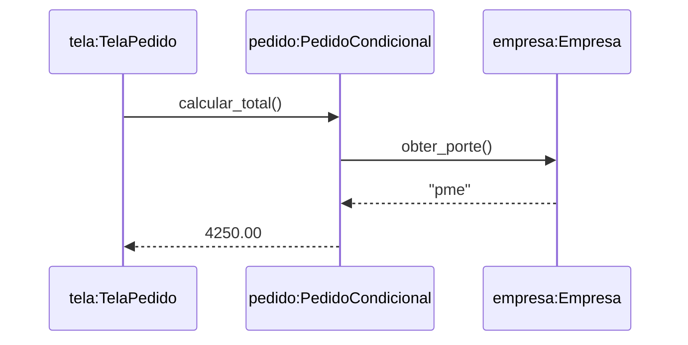
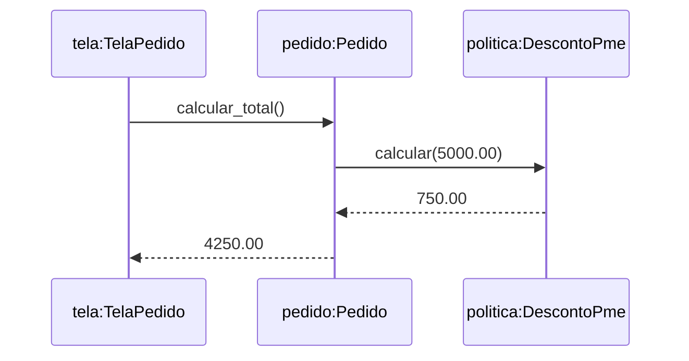

# Sistema de Pedidos com Descontos — Strategy

Projeto didático desenvolvido para a atividade de **Engenharia de Software — Design Patterns**. O sistema calcula o total de um pedido conforme o porte da empresa e compara uma implementação com `if/elif/else` com uma versão organizada pelo padrão **Strategy**.

O objetivo é mostrar como separar regras de negócio que variam por tipo, preservar o comportamento durante a refatoração e registrar os benefícios e custos da decisão arquitetural.

## Objetivos da atividade

- Identificar o maior condicional por tipo do projeto.
- Representar um cenário em um diagrama de sequência com objetos e mensagens.
- Explicar qual variação um padrão absorve.
- Escolher um padrão e justificar a decisão.
- Registrar a escolha, as alternativas e as consequências em um ADR.

Este projeto foi criado especificamente para a atividade; não é a refatoração de um sistema comercial existente.

## Regras de negócio

Os percentuais abaixo são fictícios e seguem o tema do notebook utilizado em aula.

| Porte da empresa | Desconto | Desconto em R$ 5.000 | Total do pedido |
| --- | ---: | ---: | ---: |
| Startup | 10% | R$ 500,00 | R$ 4.500,00 |
| PME | 15% | R$ 750,00 | R$ 4.250,00 |
| Enterprise | 20% | R$ 1.000,00 | R$ 4.000,00 |
| Desconhecido | 0% | R$ 0,00 | R$ 5.000,00 |

O cálculo segue a fórmula:

```text
Desconto = valor do pedido × percentual
Total = valor do pedido − desconto
```

- Valores negativos ou não finitos, como `NaN` e `Infinity`, são rejeitados.
- O valor zero é permitido.
- O porte é normalizado com remoção de espaços nas extremidades e conversão para letras minúsculas. Assim, `" PME "` é tratado como `"pme"`.
- Os cálculos monetários utilizam `Decimal`.
- O total é arredondado para duas casas decimais com o modo padrão `ROUND_HALF_EVEN`.
- Recomenda-se fornecer valores monetários como strings, por exemplo `"5000.00"`, para evitar imprecisões originadas em cálculos prévios com `float`.

## Tecnologias e requisitos

- Python **3.7 ou superior**, devido ao uso de `dataclasses`.
- Biblioteca padrão: `abc`, `dataclasses`, `decimal` e `unittest`.
- VS Code ou outro editor, opcionalmente.

Não é necessário instalar pacotes com `pip`, configurar banco de dados ou utilizar Jupyter. O projeto é uma demonstração pelo terminal e não possui interface gráfica.

## Estrutura do projeto

| Arquivo | Responsabilidade |
| --- | --- |
| `modelos.py` | Define `Empresa` e a validação dos valores monetários. |
| `antes.py` | Contém `PedidoCondicional`, com a decisão por porte em `if/elif/else`. |
| `strategy.py` | Define a interface das políticas, as estratégias, o seletor e o `Pedido` refatorado. |
| `main.py` | Define `TelaPedido` e executa a comparação entre as duas versões. |
| `test_descontos.py` | Verifica resultados, equivalência e validações com `unittest`. |
| `docs/ADR-001.md` | Registra a decisão arquitetural e suas consequências. |
| `docs/antes.mmd` | Contém o diagrama de sequência da versão original em Mermaid. |
| `docs/depois.mmd` | Contém o diagrama de sequência da versão com Strategy em Mermaid. |
| `docs/Relatorio_Design_Patterns.pdf` | Reúne a explicação da atividade, os diagramas e o ADR. |

## Como executar

### 1. Abrir o projeto

Extraia o ZIP. No VS Code, selecione **File > Open Folder** e abra a pasta `projeto_descontos`, que contém `main.py`.

Abra **Terminal > New Terminal**. Os comandos abaixo devem ser executados nessa pasta.

### 2. Conferir o Python

```bash
python --version
```

No Windows, se `python` não estiver disponível, tente:

```bash
py --version
```

No Linux ou macOS, o comando pode ser `python3`. Use o mesmo comando escolhido nos passos seguintes.

### 3. Executar a demonstração

```bash
python main.py
```

Alternativa no Windows:

```bash
py main.py
```

### Saída esperada

```text
startup    | antes: R$ 4500.00 | Strategy: R$ 4500.00
pme        | antes: R$ 4250.00 | Strategy: R$ 4250.00
enterprise | antes: R$ 4000.00 | Strategy: R$ 4000.00
outro      | antes: R$ 5000.00 | Strategy: R$ 5000.00
```

A demonstração utiliza dados fixos. Ela não solicita informações pelo teclado. Os pontos na saída correspondem à formatação numérica do programa.

## Como executar os testes

Na pasta do projeto, execute:

```bash
python -m unittest -v
```

Alternativa no Windows:

```bash
py -m unittest -v
```

A suíte possui três métodos de teste, com subcasos:

| Teste | O que verifica |
| --- | --- |
| `test_resultados_e_equivalencia` | Resultados esperados e equivalência das versões para os quatro portes. |
| `test_zero_e_normalizacao` | Pedido de valor zero e normalização de `" PME "`. |
| `test_valor_invalido` | Rejeição de valor negativo, `NaN` e `Infinity` na versão Strategy. |

A execução deve terminar com `OK`. Ambas as versões usam a mesma função de validação em `modelos.py`.

## Implementação antes do padrão

O maior condicional por tipo está em **`PedidoCondicional.calcular_total()`**, no arquivo `antes.py`.

O método consulta o porte da empresa e escolhe uma das três regras de desconto. Quando o porte não corresponde a uma categoria conhecida, aplica desconto zero.

Essa solução é curta e adequada para regras pequenas e estáveis. Entretanto, nesse formato, adicionar outra regra exige alterar o método que já contém as regras anteriores.

## Implementação com Strategy

O padrão escolhido é **Strategy**, da família dos padrões comportamentais. Cada regra de desconto fica em uma classe com a mesma interface.

| Papel no padrão | Elemento do projeto |
| --- | --- |
| Interface de estratégia | `PoliticaDesconto` |
| Estratégias concretas | `DescontoStartup`, `DescontoPme`, `DescontoEnterprise` e `SemDesconto` |
| Contexto que utiliza uma estratégia | `Pedido` |
| Ponto central de seleção | `selecionar_politica(porte)` |
| Objeto que configura e inicia o cálculo | `TelaPedido` |

`PoliticaDesconto.calcular(valor)` retorna **o valor do desconto**, e não o total do pedido. `Pedido.calcular_total()` subtrai esse desconto do valor original.

O fluxo da versão refatorada é:

1. `TelaPedido` consulta o porte da empresa.
2. `selecionar_politica()` cria a política correspondente.
3. `TelaPedido` cria um `Pedido` com essa política.
4. `Pedido` chama `politica.calcular(valor)`.
5. `Pedido` subtrai o desconto e retorna o total arredondado.

A seleção por tipo continua existindo, centralizada no seletor. O `Pedido` deixa de conhecer os portes e passa a depender apenas da interface da política.

**Qual variação o padrão absorve?** Strategy absorve a variação das regras de desconto conforme o porte da empresa, permitindo alterar cada regra sem modificar o cálculo do total em `Pedido`.

### Exemplo de uso

Execute este código em outro arquivo na mesma pasta do projeto ou no interpretador Python aberto nessa pasta:

```python
from modelos import Empresa
from main import TelaPedido

empresa = Empresa(nome="Empresa Exemplo", porte="pme")
tela = TelaPedido()

total = tela.calcular_depois(empresa, "5000.00")
print(f"Total: R$ {total:.2f}")
# Total: R$ 4250.00
```

Também é possível fornecer uma política diretamente ao contexto:

```python
from strategy import Pedido, DescontoPme

pedido = Pedido("5000.00", DescontoPme())
print(pedido.calcular_total())
# 4250.00
```

## Cenário e diagramas de sequência

O cenário analisado é um pedido de **R$ 5.000,00** feito por uma **PME**. O desconto é de **R$ 750,00**, e o total é de **R$ 4.250,00**.

### Antes: decisão dentro do pedido



O condicional ocorre internamente em `calcular_total()`. O diagrama mostra apenas os objetos e as mensagens do cenário escolhido.

### Depois: cálculo delegado à política



O segundo diagrama começa com o `Pedido` já configurado com `DescontoPme`. A consulta ao porte e a seleção da política acontecem antes desse trecho.

Os diagramas são exibidos em visualizadores compatíveis com Mermaid, incluindo o GitHub. Também estão renderizados no PDF.

## Decisão arquitetural — ADR-001

A decisão completa está em [docs/ADR-001.md](docs/ADR-001.md).

| Aspecto | Decisão ou consequência |
| --- | --- |
| Status | Aceito no projeto didático. |
| Decisão | Separar as regras com Strategy e injetar a política em `Pedido`. |
| Benefício | Alterar e testar cada política isoladamente. |
| Benefício | Manter `Pedido` independente dos portes específicos. |
| Custo | Criar mais classes e manter o seletor de políticas. |
| Alternativa | Preservar o condicional para regras pequenas e estáveis. |
| Limite | O exemplo não demonstra problemas reais de manutenção que exijam o padrão em produção. |

A escolha tem finalidade didática. **“Nenhum ainda” também seria uma decisão válida** para este cálculo simples, caso as regras permanecessem estáveis.

### Por que não os outros padrões?

- **Factory Method:** trata variações na criação por especialização de criadores. O seletor deste projeto é uma fábrica simples; ele não implementa o Factory Method GoF.
- **Observer:** seria adequado para notificar interessados sobre mudanças. O cenário não possui notificações.
- **Adapter:** seria adequado para integrar interfaces incompatíveis. Não há integração externa.
- **Decorator:** permitiria adicionar comportamentos por camadas. O problema escolhido é variar a regra de desconto.

## Como adicionar uma política

Para incluir uma nova categoria, crie uma classe em `strategy.py` que implemente `PoliticaDesconto` e registre essa classe no dicionário de `selecionar_politica()`.

Exemplo hipotético de categoria com 12% de desconto:

```python
class DescontoParceiro(PoliticaDesconto):
    def calcular(self, valor):
        return valor * Decimal("0.12")
```

No dicionário do seletor, acrescente:

```python
"parceiro": DescontoParceiro,
```

Esse exemplo é uma sugestão de extensão e não está implementado. Uma extensão deve incluir testes da nova regra. Se a comparação entre as duas versões continuar fazendo parte da demonstração, atualize também a versão original e os resultados esperados.

## Limitações

- Demonstração no terminal com dados fixos.
- Sem persistência, autenticação, interface gráfica ou API.
- Sem impostos, frete, cupons ou combinação de descontos.
- O porte deve ser uma string; não há validação específica para outros tipos.
- Políticas personalizadas devem respeitar o contrato de retorno de `Decimal`. O `Pedido` não verifica se uma política retorna desconto negativo ou superior ao valor original.
- Valores que não podem ser convertidos para `Decimal` geram a exceção da própria conversão.

## Problemas comuns

| Problema | Como resolver |
| --- | --- |
| `python` não é reconhecido | Tente `py` no Windows ou `python3` no Linux/macOS; confira a instalação do Python. |
| O terminal não encontra `main.py` | Abra o terminal na pasta `projeto_descontos`, onde está o arquivo. |
| `ModuleNotFoundError` para módulos do projeto | Extraia todos os arquivos e mantenha os arquivos `.py` na mesma pasta. |
| O README mostra o código Mermaid sem desenho | Consulte o PDF ou um visualizador com suporte a Mermaid. |

## Materiais de referência

- **Aula 08 — Padrões GoF.pdf**, professor Leandro Ramos da Silva, 2026: padrões, diagramas de sequência, refatoração e ADR.
- **DesignPatterns.ipynb**, fornecido na aula: exemplos dos cinco padrões aplicados a descontos por porte de empresa.

O código e a documentação foram elaborados para esta atividade. Os materiais originais da aula não são redistribuídos no pacote.
